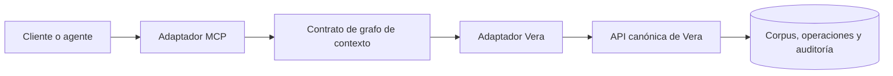

# `@vera/mcp`

La puerta de Vera para personas y agentes que hablan
[Model Context Protocol](https://modelcontextprotocol.io/). Forma parte integral
del monorepo de Vera, comparte su API canónica y su corpus, pero se ejecuta como
un proceso separado para aislar transporte, autenticación y fallos.

Hoy es un paquete privado del workspace, no un producto ni un repositorio
independiente. La [explicación pública](https://vera.mediafranca.net/vera-puerta-mcp/)
vive en Vera; aquí quedan la frontera arquitectónica, el contrato operativo y el
camino para convertir sus partes generales en infraestructura reutilizable.

La puerta ofrece lectura y escritura no destructiva. Cada lectura queda en el
registro de exposición y cada escritura pasa por la API canónica, con la
identidad y los alcances de la credencial. MCP nunca abre la base de datos.

## Naturaleza del componente

El nombre provisional de la capacidad general es **Context Graph Gateway** —una
pasarela de grafo de contexto gobernado—. No es simplemente RAG:

- **recupera** texto, propiedades, vecindades e historia;
- **compone** contexto con presupuesto, omisiones y cursores explícitos;
- **conserva procedencia** hasta página, bloque, revisión y autoría;
- **gobierna autoridad** por identidad, territorio y capacidad;
- **actúa** mediante operaciones versionadas o propuestas humanas revisables;
- **registra exposición**: qué contexto salió, hacia quién y por qué superficie.

La recuperación híbrida, los embeddings o Graph RAG pueden vivir dentro del
compositor. No deben definir el componente ni reemplazar identidades, citas,
revisiones o consentimiento.

## Frontera



**Vera conserva:** corpus, ontología propia, almacenamiento, participantes,
credenciales, operaciones, revisiones, propuestas y registro de exposición.

**El contrato reutilizable define:** recursos de contexto, consulta y
paginación; presupuestos; evidencia y omisiones; precondiciones de revisión;
concesiones; propuestas y recibos de exposición. No conoce SQLite, títulos
especiales de Vera ni su interfaz.

**El adaptador MCP traduce:** tools, resources, structured output,
subscriptions y errores del protocolo. No decide por sí solo quién puede leer o
escribir.

**`@vera/mcp` integra:** el contrato y el adaptador MCP con la API de Vera. Es la
implementación de referencia, no una segunda memoria.

### Lo que no debe cruzar la frontera

- leer directamente la base para ahorrar una llamada;
- duplicar permisos o reglas editoriales dentro del adaptador;
- mantener una caché que pueda contradecir al corpus;
- llamar «verdad» a la similitud semántica;
- exigir MCP a futuros consumidores del contrato;
- extraer paquetes generales antes de probarlos con un segundo consumidor.

## Arquitectura objetivo

La separación se hará dentro del monorepo antes de considerar otro repositorio:

| Capa | Responsabilidad | Destino probable |
| --- | --- | --- |
| Núcleo | Tipos, puertos y contratos de un grafo de contexto gobernado. | `@mediafranca/context-graph` |
| Adaptador MCP | Traducción del núcleo al protocolo MCP. | `@mediafranca/context-graph-mcp` |
| Adaptador Vera | Mapeo entre esos puertos y la API canónica de Vera. | `@vera/mcp` |

Los nombres son provisionales. La frontera importa más que bautizar pronto otro
paquete. Vera seguirá desplegando la puerta como parte integral del producto,
aunque el núcleo llegue a ser reutilizable por otra iniciativa —por ejemplo un
piloto con Solid—.

## Roadmap de modularización

### M0 — Explicitar la frontera

- [x] Documentar naturaleza, responsabilidades y antipatrones.
- [x] Mantener MCP como puerta de la API, no de la base.
- [ ] Inventariar qué tipos y reglas son generales y cuáles pertenecen a Vera.
- [ ] Unificar versión de paquete, servidor y documentación en un solo origen.

### M1 — Extraer puertos sin mover paquetes

- [ ] Definir interfaces para consulta, lectura versionada, composición,
  propuestas, exposición y concesiones.
- [ ] Hacer que tools y transportes dependan de esos puertos, no de respuestas
  HTTP específicas de Vera.
- [ ] Fijar el contrato con pruebas de conformidad independientes del servidor.

### M2 — Separar workspaces dentro del monorepo

- [ ] Crear el núcleo y el adaptador MCP como paquetes internos privados.
- [ ] Dejar en `@vera/mcp` sólo traducción, configuración y despliegue de Vera.
- [ ] Mantener una única suite de conformidad para stdio y Streamable HTTP.
- [ ] Versionar juntos mientras sólo exista un consumidor.

### M3 — Probar un segundo consumidor

- [ ] Implementar un adaptador pequeño sobre otro grafo —Solid es un candidato,
  no una dependencia asumida—.
- [ ] Registrar qué conceptos sobreviven sin Vera y cuáles eran accidentales.
- [ ] Comparar consultas, procedencia, autoridad y revisión humana en ambos.

### M4 — Decidir publicación independiente

- [ ] Publicar paquetes sólo si dos consumidores usan el mismo contrato sin
  bifurcarlo.
- [ ] Entonces decidir repositorio propio, gobernanza, nombre, versionado y
  licencia; antes sería separación administrativa sin independencia real.
- [ ] Documentar previamente cualquier resultado de investigación o activo
  intelectual que requiera una estrategia distinta de la divulgación pública.

### M5 — Ampliar el gateway

- [ ] Resources y plantillas URI para páginas, bloques, consultas y medios.
- [ ] `vera_contexto`: contexto compuesto con evidencia, presupuesto y omisiones.
- [ ] Suscripciones, archivos gobernados y concesiones legibles.
- [ ] Evaluar recuperación híbrida y Graph RAG contra preguntas reales, no por
  prestigio algorítmico.

## Qué ofrece

| Herramienta | Qué hace |
| --- | --- |
| `vera_quien_soy` | Comprueba la conexión, la identidad y los alcances. La primera llamada. |
| `vera_buscar` | Extractos de todo el corpus, con la página y el bloque de donde salieron. |
| `vera_consultar` | Consulta estructurada de propiedades, texto y enlaces, con resultados y cursor. |
| `vera_leer_pagina` | Una página por tramos, con sangría, autoría, revisión y cursor; la vecindad es optativa. |
| `vera_historia_bloque` | Todo lo que un bloque dijo alguna vez, incluido lo borrado. |
| `vera_vecindario` | El mapa alrededor de una página. |
| `vera_indice` | Los títulos del corpus. |
| `vera_preparar_escritura` | Lee juntas las reglas vivas para agentes y la ontología antes de escribir. |
| `vera_escribir` | Crea páginas o bloques y gestiona propiedades mediante una operación atribuida e idempotente. |
| `vera_editar_bloque_propio` | Corrige palabras vigentes del mismo agente con la revisión exacta que leyó; falla ante conflictos. |
| `vera_mover_bloque_propio` | Mueve estructura propia contra la revisión exacta sin cambiar la autoría del texto. |
| `vera_proponer_edicion` | Deja una corrección sobre palabras ajenas en la cola privada de revisión sin modificar el corpus. |
| `vera_escribir_lote` | Aplica una intervención nueva como lote atómico e idempotente. |
| `vera_ontologia` | Cómo está clasificada esta memoria. |

La revisión de un bloque es el identificador de la última operación que lo tocó.
Una edición de agente sin esa revisión falla; una revisión obsoleta devuelve un
conflicto y el contenido vigente. La herramienta estrecha sólo reescribe palabras
del mismo participante. Mover conserva la autoría. Las palabras ajenas pasan por
una propuesta que una persona puede aceptar, rechazar o encontrar en conflicto.
Una credencial administrativa no cercada conserva su autoridad amplia, pero
también debe presentar la revisión exacta.

## Cómo se conecta cada cliente

La guía completa —el método general, válido para cualquier proveedor, con la
tabla de qué pide cada formulario y qué hacer cuando falla— está en
[docs/conectar-una-ia.md](../../docs/conectar-una-ia.md). Aquí quedan las cuatro
recetas de siempre.

Vera tiene que estar corriendo (`npm run serve`, por omisión en el 4173).

No hay una forma «más nueva» que deba sustituir a todas las demás. En la máquina
donde vive Vera, `stdio` evita una vuelta innecesaria por Internet. En otro
equipo, Streamable HTTP elimina el repositorio, SSH y Tailscale. El contrato, la
identidad y los alcances son los mismos; cambia sólo el recorrido.

**Claude Code** — ya está: el `.mcp.json` de la raíz del repositorio lo declara.
Al abrir Claude Code aquí, pregunta si se confía en el servidor del proyecto.
Para tenerlo en cualquier directorio y no sólo en éste:

```sh
claude mcp add vera --scope user -- \
  node --experimental-strip-types --no-warnings \
  /home/hspencer/Sites/vera/packages/mcp/src/main.ts
```

**Claude Desktop** — en `claude_desktop_config.json`:

```json
{
  "mcpServers": {
    "vera": {
      "command": "node",
      "args": ["--experimental-strip-types", "--no-warnings",
               "/home/hspencer/Sites/vera/packages/mcp/src/main.ts"],
      "env": { "VERA_URL": "http://127.0.0.1:4173", "VERA_CLIENT": "claude-desktop" }
    }
  }
}
```

**Claude Code por la puerta pública** — desde cualquier red, sin Tailscale ni
SSH. La variable se expande al cargar la configuración y el secreto no entra en
Git:

```json
{
  "mcpServers": {
    "vera": {
      "type": "http",
      "url": "https://vera.mediafranca.net/mcp",
      "headers": { "Authorization": "Bearer ${VERA_CLAUDE_TOKEN}" }
    }
  }
}
```

En alcance personal, el mismo bloque se registra así:

```sh
claude mcp add-json --scope user vera \
  '{"type":"http","url":"https://vera.mediafranca.net/mcp","headers":{"Authorization":"Bearer ${VERA_CLAUDE_TOKEN}"}}'
```

Después: `claude mcp list`, `claude mcp get vera`, `/mcp` y
`vera_quien_soy`. La identidad debe ser la de Claude, nunca
`participant:herbert`.

**LM Studio** — desde 0.3.17 admite servidores remotos en `mcp.json`. Abre
Program → Install → Edit mcp.json y añade:

```json
{
  "mcpServers": {
    "vera": {
      "url": "https://vera.mediafranca.net/mcp",
      "headers": {
        "Authorization": "Bearer <TOKEN_EXCLUSIVO_DE_LM_STUDIO>"
      }
    }
  }
}
```

Su documentación no promete expansión de variables dentro de `headers`: el
bearer queda escrito en ese archivo. Usa una credencial exclusiva, protege el
archivo y no generes un deeplink con esa configuración, porque transportaría el
secreto dentro de la URL. Con un modelo capaz de usar herramientas, prueba
`vera_quien_soy`, luego `vera_preparar_escritura` y una escritura pequeña. En
Alexei conviene la declaración `stdio` de arriba: es más rápida y puede leer un
`VERA_TOKEN_FILE` privado.

**Codex local** — en `~/.codex/config.toml`, siempre con una credencial propia:

```toml
[mcp_servers.vera]
command = "/usr/bin/node"
args = ["--experimental-strip-types", "--no-warnings",
        "/home/hspencer/Sites/vera/packages/mcp/src/main.ts"]
env = { VERA_URL = "http://127.0.0.1:4173", VERA_CLIENT = "codex", VERA_TOKEN_FILE = "/ruta/privada/vera-codex.token" }
```

**Codex en otro equipo** — no copies el secreto ni el repositorio. Abre
«VERA: Conexiones», elige «otro equipo» y copia el bloque TOML calculado para
esa conexión. En el despliegue de Alexei, `codex-andrei` arranca la puerta por
SSH y descifra allí `vera-codex.cred`; el bloque deja la conexión como
`required = true` y evita aprobaciones MCP redundantes. Comprueba el resultado
con `codex mcp list`, luego `/mcp`, y llama primero a `vera_quien_soy`: debe
responder `participant:codex`. Otra identidad es un fallo de configuración.

**Codex y OpenAI por la puerta pública** — desde cualquier red, sin Tailscale ni
SSH:

```sh
export VERA_CODEX_TOKEN='el secreto de la credencial de Codex'
codex mcp add vera --url https://vera.mediafranca.net/mcp \
  --bearer-token-env-var VERA_CODEX_TOKEN
```

El secreto vive en el equipo cliente como variable protegida; no se escribe en
`config.toml`. La URL es pública, el corpus no: sin bearer válido la puerta
responde `401` antes de inicializar MCP o enumerar herramientas.

OpenAI puede compartir la configuración de plugins y aplicaciones entre Codex y
ChatGPT. Un formulario con `STDIO`, comando y variables no demuestra por sí solo
que la conexión sea exclusiva de Codex. Para la puerta remota se usa
`https://vera.mediafranca.net/mcp`, autenticación `Ninguna` y la cabecera
`authorization` con valor `Bearer <TOKEN_EXCLUSIVO_DE_CHATGPT>`. Después de
guardar o escanear la aplicación hay que confirmar que esté habilitada en el
mismo espacio/proyecto, abrir un chat nuevo y seleccionarla en **+ → Más** o
invocarla con `@Vera`. Configurarla y exponerla en una conversación son pasos
distintos. No añadas `x-vera-client`; Vera deriva la
identidad del token. La guía completa está en
[docs/conectar-una-ia.md](../../docs/conectar-una-ia.md).

El token lo genera Vera al crear la conexión en «VERA: Conexiones» y se muestra
una sola vez. Para la conexión ya existente «Codex en Andrei» hay una copia
cifrada en Alexei; no hace falta emitir otra. Si el secreto se pierde, no se
recupera: se revoca la credencial y se crea una nueva. La instalación pública en
Andrei queda pendiente hasta tener acceso a ese equipo.

**Gemini CLI** — en `~/.gemini/settings.json`:

```json
{
  "mcpServers": {
    "vera": {
      "command": "node",
      "args": ["--experimental-strip-types", "--no-warnings",
               "/home/hspencer/Sites/vera/packages/mcp/src/main.ts"],
      "env": { "VERA_URL": "http://127.0.0.1:4173", "VERA_CLIENT": "gemini" }
    }
  }
}
```

No uses una receta sin credencial como configuración normal: en loopback puede
caer silenciosamente al dueño y atribuirle a Herbert las lecturas o escrituras
del agente.

Los clientes configurables ya pueden conectarse por Streamable HTTP.
«Públicamente alcanzable» no significa publicar la aplicación privada ni
permitir lecturas anónimas. OAuth sigue siendo M6 para los servicios alojados
que lo exijan; no es requisito de Codex, Claude Code ni ChatGPT cuando el
formulario permite proporcionar el bearer como cabecera propia.

## Latencia: pública no significa local

Medición real desde Alexei, 2026-08-26, treinta llamadas consecutivas a
`vera_quien_soy`:

| Transporte | Arranque | Mediana por herramienta | p95 |
| --- | ---: | ---: | ---: |
| `stdio` local | 152 ms | 12,3 ms | 14,8 ms |
| HTTPS pública | 1.171 ms | 293,2 ms | 487,6 ms |

La diferencia está en el recorrido TLS/Cloudflare, no en el corpus ni en MCP.
Por eso el bibliotecario y los clientes que corren en Alexei conservan el camino local.
La puerta pública se usa donde compra algo concreto: acceso desde otra red sin
SSH, tailnet ni copia del código. En otro equipo hay que medir allí antes de
retirar el transporte anterior.

## El entorno

| Variable | Para qué | Por omisión |
| --- | --- | --- |
| `VERA_URL` | Dónde está la API. | `http://127.0.0.1:4173` |
| `VERA_TOKEN_FILE` | Archivo con el secreto de la credencial. | — |
| `VERA_TOKEN` | El secreto, si no hay archivo. | — |
| `VERA_SYSTEMD_CREDENTIAL_FILE` | Credencial cifrada que se abre donde corre la puerta. | — |
| `VERA_SYSTEMD_CREDENTIAL_NAME` | Nombre embebido de esa credencial cifrada. | — |
| `VERA_CLIENT` | Cómo se declara el cliente en el registro de exposición. | `vera-mcp` |

La credencial no se pasa nunca por argumentos: los argumentos de un proceso los
lee cualquiera con un `ps`. `VERA_TOKEN_FILE` antes que `VERA_TOKEN`, porque una
variable de entorno se hereda a todo lo que el proceso lance y un archivo con
permisos no.

Para una puerta lanzada por ssh, la pareja `VERA_SYSTEMD_CREDENTIAL_*` tiene
precedencia y falla cerrada: si no puede descifrarse, el servidor MCP no inicia
y nunca cae a la identidad del dueño por loopback.

Sin credencial se entra como el dueño, que es lo que hoy es cierto en casa. El
registro de exposición lo anota como lo que es —una lectura sin credencial— en
vez de disimular la ausencia.

## Lo que queda anotado

Cada lectura escribe una fila compacta en el registro de exposición de VERA:
quién, con qué credencial, qué cliente dijo ser, por qué superficie entró,
cuántos elementos de contexto recibió y cuánto medía la respuesta. Se mira en
`GET /exposures` y se filtra por participante y período. Las identidades de cada
bloque no se duplican dentro del registro.
